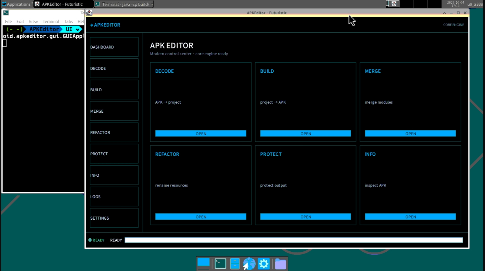
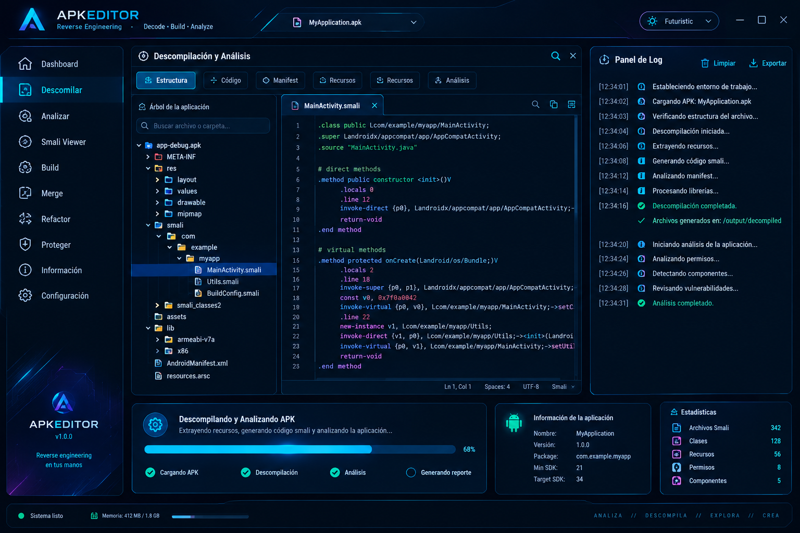

<p align="center">
  <b>APKEditor Futuristic - Interfaz</b>
</p>

## Descripción

APKEditor Futuristic es una interfaz gráfica moderna que envuelve el motor original de APKEditor.

## Documentación

La documentación completa de la interfaz, la arquitectura, la ejecución y la solución de problemas está en:

- [docs/apkeditor-ui.md](docs/apkeditor-ui.md)

## Objetivo final



> [!WARNING]
> Todo esta impulsado por IA puede terner cambios radicales 

> [!NOTE]
> Todo lo trataré de documentar. Todas mis ideas y el progreso estarán en `/docs/`.

## Requisitos

- JDK 21.
- Gradle Wrapper incluido en el repositorio.
- Los archivos de `libs/`: `ARSCLib.jar`, `smali.jar` y `JCommand.jar`.
- Un servidor gráfico X11:
  - Linux de escritorio: Xorg/Wayland con XWayland.
  - Termux: VNC (`Xvnc`) o `Termux:X11`.

## Compilación

```bash
sh gradlew compileJava --offline
```

Compilación completa sin pruebas:

```bash
sh gradlew build -x test --offline
```

Fat jar con dependencias:

```bash
sh gradlew fatJar --offline
```

El fat jar se genera en:

```text
build/libs/APKEditor-1.4.9-all.jar
```

> Usa `sh gradlew` si `./gradlew` falla con `permission denied`.

## Iniciar la interfaz gráfica

### Opción 1 - Classpath de desarrollo

```bash
sh gradlew compileJava --offline

java -cp 'build/classes/java/main:build/resources/main:libs/*' \
  com.reandroid.apkeditor.gui.GUIApplication
```

### Opción 2 - Fat jar

```bash
sh gradlew fatJar --offline

java -cp build/libs/APKEditor-1.4.9-all.jar \
  com.reandroid.apkeditor.gui.GUIApplication
```

### Termux con VNC

```bash
cd /data/data/com.termux/files/home/proyecto/APKEditor

export DISPLAY=:0
export XAUTHORITY="$HOME/.Xauthority"

java -cp 'build/classes/java/main:build/resources/main:libs/*' \
  com.reandroid.apkeditor.gui.GUIApplication
```

Después abre el visor VNC en `localhost:5900` o en el puerto configurado.

### Termux con Termux:X11

```bash
export DISPLAY=:0
termux-x11 :0 &
```

Abre la aplicación Termux:X11 y ejecuta el comando Java de la GUI.

> Importante: `sh gradlew run` ejecuta el CLI (`com.reandroid.apkeditor.Main`), no la interfaz gráfica. Para abrir la GUI hay que indicar `com.reandroid.apkeditor.gui.GUIApplication`.

## Uso rápido

1. Abre la GUI.
2. Pulsa el selector de APK o usa `Ctrl+O`.
3. Elige un archivo APK/ZIP.
4. Explora el árbol, abre archivos en el editor y revisa los logs.
5. Usa `F5` o el botón **Descompilar** para generar el proyecto.
6. Usa las vistas **Build**, **Merge**, **Refactor** y **Proteger** para ejecutar las operaciones del motor.

## Estado

La interfaz actual está implementada con Swing + Java2D. El detalle de módulos, atajos, temas, operaciones y limitaciones está en [docs/apkeditor-ui.md](docs/apkeditor-ui.md).
